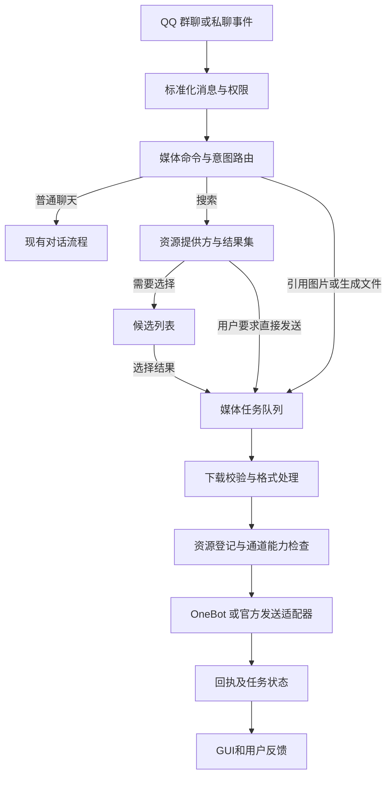

> 实施补记：本方案保留为设计记录。代码、配置、GUI 和自动化验证已落地，实际支持范围与尚未进行的真实 QQ 联调见 [实施报告](G:/qqbot/IMPLEMENTATION_REPORT.md)。

建议以 **OneBot / NapCat 为首个完整交付通道**，先实现图片、短视频和通用文件的可靠发送，再接入搜索和自然语言操作；官方 QQ 通道使用独立适配器。核心流程是：**理解请求 → 搜索真实资源 → 下载与校验 → 按通道发送 → 根据回执反馈结果**。

本文件为基于 2026-10-27 工作区的设计方案，功能尚未实现。审阅发现与测试证据见 [代码审阅报告](G:/qqbot/CODE_REVIEW_REPORT_2026-10-27.md)。

**当前代码可以复用的部分**

| 已有能力 | 当前位置 | 如何复用 |
| --- | --- | --- |
| 图片、表情、引用图片的接收与缓存 | `image_handler.py`、两种客户端 | 复用提取、Pillow 元信息和引用关联；下载边界应先修复 |
| OneBot WebSocket RPC 和 echo 分发 | `onebot_client.py:243` | 增加回执校验、可配置超时、断线清理和结构化消息段 |
| 官方 SDK 媒体上传与媒体消息接口 | 已安装的 `qq-botpy 1.2.1` | SDK 已有方法，业务客户端尚未接入 |
| 人设、会话、群上下文和 GUI 消息流 | `prompt_builder.py`、记忆模块、GUI | 保留普通聊天，补充媒体意图、任务状态和发送记录 |
| 梗词条搜索 | `web_search.py` | 继续负责解释梗；另建媒体搜索服务，其返回值必须包含真实资源与来源 |

现有 `web_search.py` 主要查询梗含义，返回短释义，不提供图片或视频搜索结果。当前回复路径主要传文本字符串；图片本地路径写进提示词，只用于尝试让后端理解输入图片，并不等于 QQ 已支持发送图片。机器可定位到 ffmpeg、ffprobe，但项目尚未管理这两个外部依赖，部署时仍需检查。

**用户可以怎样说，bot 应怎样执行**

以下为目标交互，不表示所有资源源站现已接入。涉及平台视频的搜索，需要先实现对应资源提供方。

| 用户指令示例 | 预期返回 | 默认处理 |
| --- | --- | --- |
| “搜三张橘猫图片发给我” | 3 张图片，附一条简短来源说明 | 直接完成检索与发送，结果不足则说明实际数量 |
| “找一张 9:16 的星空手机壁纸” | 符合比例的图片 | 优先较高分辨率，找不到精确比例时说明接近条件 |
| “发个生气猫猫的表情包” | 1 张匹配的图片或动图 | 优先自建表情库，再查已接入图库 |
| 引用图片：“把这张原图作为文件发我” | 原图文件 | 通过引用资源 ID 找到图片；若原图未取到，不把缩略图冒充原图 |
| “搜几个一分钟以内的猫咪视频” | 3 条候选：标题、时长、来源，按能力附封面 | 先返回搜索结果，不批量下载视频 |
| “把第二个视频发过来” | 第 2 条的短视频或可下载文件 | 从本人最近结果集取资源；可下载时处理，否则给原页面和原因 |
| “这个 mp4 链接下载后直接发我” | 可播放短视频 | 用户已明确要求发送，校验通过后直接执行 |
| “搜 Python 官方教程 PDF 发我” | 找到的官方 PDF 或明确的检索结果 | 只发送实际检索到的文件；官网只有网页时如实说明，可按用户意图另生成整理版 |
| “把上一条回答整理成 txt 发我” | UTF-8 文本附件 | 程序生成 `.txt`；内容不会因聊天长度限制被截断 |
| “把这些数据整理成 CSV 文件” | CSV 附件 | 程序生成并保留字段、编码；文档生成与网页搜索共用发送器 |
| “查群文件里的活动通知，发最新那份” | 当前群内可访问的匹配文件 | 仅查询本群文件，按可验证的文件时间排序 |
| “把资料库里的安装说明发我” | 已登记资料库文件 | 匹配名称和标签；多个同名时返回候选 |
| “第二张换一张”“只要原图”“下一页” | 基于同一次搜索调整结果 | 绑定当前用户、群/私聊、账号和结果集，避免串用他人的候选 |
| “取消刚才的下载”“任务进度” | 取消结果或当前阶段 | 支持查询排队、下载、转换、上传状态；已发出的消息不能靠取消撤回 |

输入“搜猫”这种没有媒体类型的请求，先给简短的综合搜索结果或按对话中已经明确的类型处理；只有类型歧义影响结果时再询问。用户已经明确说“搜三张并发给我”，不再额外要求选择。搜索到需要选择的大文件或视频时，候选使用稳定的结果编号；“第二个”同时有多组可能结果时，以引用消息确定结果集，无法确定才澄清。

群聊中，搜索和下载由显式 @、明确指令或已配置的主人权限触发。普通聊天的自主插话默认只发文字，避免群友闲聊触发大批下载。语音可作为后续扩展：区分“发送音频附件”和“发送可播放语音”，后者需要单独编码和通道测试。

**通道能力与限制**

| 内容 | OneBot / NapCat | 官方 QQ 群聊 / C2C |
| --- | --- | --- |
| 普通图片 | `image` 消息段 | 上传后发送 `msg_type=7`，`file_type=1` |
| 动图 | 按已测 NapCat 版本发送 image，必要时改文件 | 首期按 PNG/JPG 能力实现；动图单独验证 |
| 短视频 | `video` 消息段，校验编码和大小 | 上传后发送媒体消息，`file_type=2`，优先 MP4 |
| 音频 | `record` 或通用文件，播放需编码适配 | `file_type=3`，按文档及实际通道格式处理 |
| PDF、TXT、ZIP 等通用文件 | `upload_group_file` / `upload_private_file` | 当前公开富媒体文档把 `file_type=4` 标为暂不开放；能力未确认前返回可访问链接 |
| 本地生成文件 | 同机可传受信绝对路径 | 本地路径不能直接交给腾讯服务；需受控的可访问 HTTPS URL，或另行验证新上传接口 |
| 长任务结果 | 任务完成后按权限返回 | 要满足接收消息对应的回复窗口与次数；过期时提示用户重新查询领取 |

以上基于 [NapCat API 文档](https://napneko.github.io/onebot/api)、[消息格式](https://napneko.github.io/develop/msg)、[腾讯富媒体文档](https://github.com/tencent-connect/bot-docs/blob/main/docs/develop/api-v2/server-inter/message/send-receive/rich-media.md)及本机 SDK 方法签名。官方通用文件能力按账号、场景和实际接口测试确认，不能从“SDK 接受整数 4”推出平台一定开放。

频道和频道私信另设能力项；首期覆盖群聊与 C2C，不把群聊富媒体流程直接套在频道 API 上。NapCat 与 Python 跨机器或容器部署时，Python 的本地路径对 NapCat 无意义，应上传到 NapCat 可访问的存储或使用其支持版本的文件流接口。[NapCat 文件处理指南](https://napneko.github.io/develop/file)提供了跨设备流传输说明。

**推荐的代码结构**

```text
media_models.py          # 意图、资源、任务、发送回执等 Pydantic 模型
media_router.py          # 显式命令、自然语言意图与选择操作
media_search.py          # 搜索接口、排序、去重、结果集和翻页
media_providers/         # 图片库、视频元信息、文档、群文件、已登记本地资料库
media_downloader.py      # URL 校验、流式下载、校验与缓存
media_processor.py       # 图片规范化、ffprobe/ffmpeg、封面、TXT/CSV生成
media_sender.py          # 统一发送接口及 OneBot/官方通道实现
media_jobs.py            # 队列、会话版本、进度、取消和发送账本
data/cache/media/        # 按摘要存储的媒体内容
data/media.sqlite3       # 资源元信息、任务、结果集与发送账本
```

首期可把提供方实现放在 `media_search.py` 内，达到多个源后再拆目录；避免为每个功能重新复制群聊/私聊分支。



两种客户端收到消息后先构造 `MessageEnvelope`：`account_id`、`transport`、`conversation_id`、群/私聊类型、`sender_id`、原消息 ID、时间、纯用户正文、已验证的附件和引用资源。意图识别使用纯用户正文，避免图片说明、被引用的聊天内容和抓取页面里的文字被当作新命令。

优先解析 `/image`、`/video`、`/file`、`/pick`、`/cancel` 等确定性命令，随后识别自然语言媒体意图；普通聊天继续走现有 AI 流程。群聊和私聊共用一个路由入口。

**把模型判断限制为可验证的操作**

新增独立的 `MediaIntent`，保留现有 `AIDecisionResult` 负责是否参与聊天，避免在一段自由回复中偷偷解析文件指令。

```json
{
  "operation": "search_and_send",
  "kind": "image",
  "query": "橘猫",
  "count": 3,
  "filters": {"orientation": "portrait"}
}
```

使用 Pydantic 的枚举、长度和范围限制验证。结果选择使用 `result_set_id + candidate_id`，引用图片使用服务端登记的 `asset_id`。模型可以建议关键词、种类、数量和过滤条件，不能直接决定系统路径、发送对象、任意 RPC action 或 shell 命令。用户粘贴的 URL 从消息中提取并单独校验；搜索资源的 URL 来自真实提供方结果，不从模型文本虚构。

建议的核心记录：

| 记录 | 关键字段 | 用途 |
| --- | --- | --- |
| `MediaAsset` | asset_id、来源、所属会话/用户、原页面、下载 URL、实际 MIME、大小、摘要、到期时间 | 资源可追溯，校验通过后才允许发送 |
| `SearchResultSet` | 随机 ID、账号、通道、会话、发起者、候选 ID、创建和到期时间 | 支持“第二个、下一页”，隔离不同用户的结果 |
| `ReplyContext` | 原消息 ID、回复期限、剩余条数、已分配序号、会话版本 | 统一管理官方被动回复约束 |
| `MediaJob` | job_id、owner、意图、资源 ID、阶段、截止时间、取消标志 | 慢任务脱离模型会话锁，支持重启恢复 |
| `SendReceipt` | 平台、结果状态、消息或文件标识、错误分类、重试信息 | 以平台结果驱动反馈和记忆 |

搜索结果、下载任务和发送目标全部绑定账号与会话。缓存可以按内容摘要去重，但这不授予其他用户访问同一资源的权限。群文件和本地资料库的权限检查在查询、选择和发送时均执行。

**OneBot 的具体接入方式**

1. 修复 `send_action()`：检查 `status/retcode`，可配置每种操作的超时；断线时及时失败所有待响应请求。发送超时进入未知状态，禁止直接重发。
2. `send_group_message()`、`send_private_message()` 接受结构化消息段并返回回执；纯文本调用包装成 text 段。
3. 新增 `send_image()`、`send_video()`、`send_file()`；这些函数仅接受已经登记并验证的资源。

图片载荷示例（最终 URI 由程序用 `Path.as_uri()` 构建）：

```json
{
  "action": "send_group_msg",
  "params": {
    "group_id": 123456,
    "message": [
      {"type": "text", "data": {"text": "找到的橘猫图片"}},
      {"type": "image", "data": {"file": "file:///G:/qqbot/data/cache/media/asset.jpg"}}
    ]
  },
  "echo": "job-generated-echo"
}
```

视频将图片段换为 `video`，`data.file` 指向已验证视频；可按版本添加 `thumb`。不支持或超限时转为文件发送或返回源链接。

通用文件采用对应接口：

```json
{
  "action": "upload_group_file",
  "params": {
    "group_id": 123456,
    "file": "G:/qqbot/data/cache/media/tutorial.pdf",
    "name": "教程.pdf"
  }
}
```

私聊使用 `upload_private_file` 和 `user_id`。`name` 是清理后的显示文件名，文件路径由程序维护。大文件上传使用独立超时和取消，不能沿用当前固定 10 秒 RPC 等待。

远程 NapCat 的 Stream API 有多次进度响应；当前 echo future 收到第一条就结束，不能直接用于流式接口。若采用 Stream API，另实现按 echo 聚合直到完成/失败的处理器，并锁定测试过的 NapCat 版本。

**官方 QQ 的具体接入方式**

本机 SDK 已有 `post_group_file()`、`post_c2c_file()`、`post_group_message()`、`post_c2c_message()`。示意调用如下，属于设计片段：

```python
uploaded = await api.post_group_file(
    group_openid=ctx.group_openid,
    file_type=1,                  # 视频为 2
    url=asset.public_https_url,
    srv_send_msg=False,
)
result = await api.post_group_message(
    group_openid=ctx.group_openid,
    msg_type=7,
    media={"file_info": uploaded["file_info"]},
    msg_id=ctx.inbound_message_id,
    msg_seq=ctx.allocate_sequence(),
)
```

C2C 对应改用 `post_c2c_file(openid=...)` 和 `post_c2c_message(openid=...)`。上传完成后检查 `file_info/ttl`，按通道场景维护有效期。缓存键至少包含机器人应用、上传场景、资源摘要与有效期；群聊上传所得 file_info 不能用于单聊，反向也一样。使用 `srv_send_msg=False` 避免上传时意外直接发送；这符合[腾讯富媒体文档的推荐流程](https://github.com/tencent-connect/bot-docs/blob/main/docs/develop/api-v2/server-inter/message/send-receive/rich-media.md)。

本地生成文件需要发布为受控的短期 HTTPS 下载地址。只发布要发送的资源，绑定不可猜测标识和到期时间，不映射整个工作目录；不得把 `config.yaml` 或会话缓存发布到公网。源站无法被腾讯拉取时，可先缓存再转到受控存储，不能把“上传接口已调用”当作发送成功。

按当前[官方发送文档](https://github.com/tencent-connect/bot-docs/blob/main/docs/develop/api-v2/server-inter/message/send-receive/send.md)，群聊被动回复窗口为 5 分钟、每个消息最多回复 5 次；单聊的窗口和限制单独维护，正式实现仍以实际账号接口行为校准。文字说明、进度、图片和错误提示共用同一份回复预算，不能各自从 `msg_seq=1` 开始。3 张图片可采用“1 条来源说明 + 3 条媒体”，避免连续阶段播报占满预算。官方文档还声明主动推送已停止提供，因此方案不依赖任务超时后主动补发；用户再次查询任务时使用新消息完成领取。

**搜索源与下载策略**

| 场景 | 首期资源来源 | 搜索结果应保留 |
| --- | --- | --- |
| 猫图、风景、壁纸 | 一种公开图库提供方，加可配置的图片源 | 真实媒体 URL、缩略图、原页面、尺寸、作者/许可信息 |
| 表情包 | 自建可检索表情库、用户允许保存的素材 | 标签、情绪、动图属性、来源与归属 |
| 平台视频 | 一个实际接入并可验证的站点搜索提供方 | 标题、作者、时长、封面、原页面、是否可下载 |
| MP4 链接 | 用户明确提供的 URL、已登记直链源 | 实际媒体类型、时长、大小和有效期 |
| PDF、资料 | 官方文档站、登记资料库、本群文件 | 文件名、来源页面、时间、类型和大小 |
| 生成文件 | 现有回复、用户提供的结构化数据 | 输入范围、文件类型、生成状态 |

提供方可用 API key 放在独立配置或环境变量里。无可用图片源时提示未配置，不能从 HTML 的 logo、广告图随便拼出结果。对平台视频，搜索元信息和下载视频分别实现；只能获取网页时返回标题与来源链接，不能把封面作为“视频已发送”的结果。登录、付费、失效或不可下载的结果应如实说明并提供可访问原页面。

资源排序根据关键词、尺寸/时长条件和来源可信度，去重按资源 ID、规范化 URL 和内容摘要进行。外部页面、文件名和摘要只作为数据；不将其文字提升为系统指令。找不到 PDF 时，可以提供“整理成 PDF”的独立操作，成品标注由 bot 整理，避免冒充官网原文。

下载与格式处理需要落实以下边界，直接对应审阅中的 A2、A3、A6、A11：

- HTTP(S) URL 每次解析、连接和重定向都校验目标地址；DNS 解析结果与实际连接目标保持一致。已登录资源的凭据不跨域转发。
- 逐块读取并累计字节，超过上限立即中止；同时设置连接、读取和整个任务的截止时间。MIME、扩展名和文件签名交叉验证，图片限制像素与帧数。
- 内部资源路径使用 `Path.resolve()` 后做目录归属校验，目录连接/符号链接也按最终目标检查。所有对外发送都基于资源 ID，不能让“发文件”变成任意读取磁盘。
- ffprobe 验证视频，必要时转换为 MP4/H.264/AAC 并生成封面；ffmpeg 通过参数数组启动，不使用 shell 拼接。对于本地媒体，限制允许的协议并禁用外部网络输入，防止伪装的播放列表继续访问其他资源。
- 已发送素材按摘要缓存，带 TTL 和总容量上限；下载/上传中的文件有引用计数，清理不能删除在途资源。临时文件失败后回收。

**任务状态、失败与重试**

任务阶段建议为 `queued → searching → downloading → validating → converting → uploading → accepted`；终态另有 `failed`、`cancelled` 和 `unknown`。`accepted` 表示平台受理，不表示收件人已读。各阶段有独立超时及任务总截止时间，普通聊天不等待下载锁。

用 SQLite 记录任务和发送账本，幂等键建议包含“账号、通道、会话、输入消息 ID、操作序号”。文件已经发送、客户端恰好超时的情况，先核对回执或可查询的历史；无法核对时保留 unknown，避免重试重复刷屏。群内多人同时搜索，按发起者分别保存结果；同一请求的重复事件只创建一次任务。

用户取消时停止下载/转换子进程并清理临时资源；在实际发送之前再次检查取消标志、任务归属和会话版本。平台已受理后无法保证取消，不假报已撤销。清空上下文时使旧任务失效或按产品设定显式保留，不能在清空后无提示补发旧结果。

**建议的配置与 GUI**

以下是首期建议值，属于项目策略，不是 QQ 平台的通用硬限制。与已验证通道能力取更严格的一侧。

```yaml
media:
  enabled: true
  image_enabled: true
  video_enabled: true
  file_enabled: true
  default_image_count: 3
  max_image_count: 5
  max_image_mb: 10
  max_video_mb: 50
  max_file_mb: 100
  default_video_max_seconds: 120
  download_timeout_seconds: 60
  upload_timeout_seconds: 120
  max_concurrent_downloads: 2
  per_conversation_queue_limit: 3
  cache_ttl_hours: 24
  cache_max_mb: 2048
  require_explicit_group_request: true
  local_library_roots: ["G:/qqbot/data/library"]
  image_provider: "configured_provider"
  video_provider: "configured_provider"
```

配置模型增加数值范围校验，GUI 增加“媒体功能”页：种类开关、来源状态、大小限制、缓存用量、已登记资料库和任务列表。消息监控补充图片缩略图、视频标题/时长、文件名/大小与真实回执；本地路径和敏感 URL 参数不出现在 QQ 用户回复中。管理员管理源、资料库根目录和全局开关；普通用户只能查询、发送自己或当前群可访问的资源。

**交付顺序与验收**

| 阶段 | 具体范围 | 完成条件 |
| --- | --- | --- |
| 0：发送基础 | A1/A2/A3、会话版本、队列、下载边界 | 纯文字中的 CQ 码不会触发操作；失败、超时和断线状态可辨别 |
| 1：确定性媒体发送 | OneBot 图片、MP4、群/私聊文件，TXT/CSV，引用图片 | 群聊和私聊分别真实收到三种媒体；带空格和中文文件名可用 |
| 2：搜索与选择 | 1 个图片源、文档/资料库、结果编号、“第几个/换一批” | 自然语言搜图直接发；多用户并发结果不串；资源有真实来源 |
| 3：视频处理 | 1 个视频搜索源、直链下载、ffmpeg、任务取消 | 搜索候选与真实视频区分；转码、超限降级、失败解释有效 |
| 4：官方通道 | file_info 上传、回复预算、受控资源 URL | 群聊/C2C 图片和视频联调；通用文件按实际能力启用或降级 |

首期完整使用闭环建议是：“**搜三张猫图发我 → 引用第二张让我发原图文件 → 搜三个短视频 → 发第二个 → 把搜索结果导出 TXT**”。先完成确定性发送和 1 个可用搜索源，再扩展更多内容站点。

实现时的重点回归应覆盖：模型字面 CQ 文本、失败 retcode、未知发送状态、清空与取消竞态、群冷却并发、错误 MIME、超大文件、重定向到内网、路径越界、过期结果与文件 URL、远程 NapCat 路径不可见、官方 msg_seq/预算耗尽。真实 QQ 联调验证“用户收到且可打开”；模拟 API 成功不能替代这一项。
